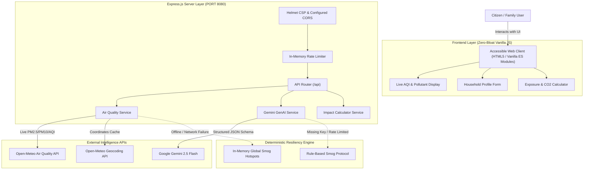

# 🌫️ Urban Air Quality Assistant

> **PromptWars Challenge 06** — Actionable winter smog routines, indoor air quality hacks, and sustainable low-emission alternatives tailored to household profiles and live ambient pollutants.

[](#quality-gates--audit-results)
[](#test-coverage)
[](#accessibility-audit)
[](#lightweight-footprint)
[](#docker--cloud-run-deployment)

---

## 🌐 Live Deployment & Demo

* 🚀 **Live Web App (Google Cloud Run):** [https://urban-air-assistant-510810666377.asia-south1.run.app](https://urban-air-assistant-510810666377.asia-south1.run.app)
* 🎬 **Live Walkthrough Video:** [https://youtu.be/DJSua4XdrUk](https://youtu.be/DJSua4XdrUk)
* 💻 **GitHub Repository:** [https://github.com/Sukumar-Manivel/urban-air-assistant](https://github.com/Sukumar-Manivel/urban-air-assistant)

---

## 📌 Problem Statement

During acute winter smog episodes, toxic particulate concentrations (PM2.5, PM10, CO) surge to hazardous levels across dense metropolitan basins. Standard weather applications display numbers without context-aware guidance. 

The **Urban Air Quality Assistant** bridges the gap between environmental data and daily human action:
1. **Live Ambient Air Quality Intelligence**: Fetches real-time PM2.5, PM10, US AQI, and CO readings by city using the Open-Meteo Air Quality & Geocoding APIs with in-memory caching and offline fallback protection.
2. **Personalized GenAI Daily Action Plans**: Powered by Google Gemini (`gemini-2.5-flash`) via `@google/genai` with strict JSON `responseSchema`. Contextualizes advice by household vulnerability (children, elderly, asthma/respiratory sensitivity, commute mode).
3. **Deterministic Emergency Fallback**: A rule-based offline engine guarantees continuous 24/7 plan generation even during API outages or quota limits.
4. **Before/After Exposure & CO₂ Reduction Calculator**: Quantifies personal PM2.5 lung exposure avoided (µg avoided) and household carbon emissions eliminated (kg CO₂e/week).
5. **DIY Indoor Air Protocols**: Actionable, low-cost interventions (DIY Box Fan MERV-13 filters, inversion ventilation timing, wet-mopping protocols).

---

## 📋 Challenge Submission Rubric

### 1. Chosen Vertical
* **Vertical:** `[Challenge 6] Urban Air Quality Assistant`
* **Focus:** Severe winter smog health protection, DIY indoor air quality filtration, and low-emission household commute planning tailored to vulnerable family members (children under 12, seniors 65+, asthma/respiratory sensitivity).

### 2. Approach and Logic
* **Live Environmental Intelligence:** Real-time city geocoding and ambient pollutant retrieval via Open-Meteo Air Quality & Geocoding APIs (`PM2.5`, `PM10`, `US AQI`, `CO`).
* **US EPA AQI Classification:** Deterministic categorization of air hazard levels (`Good`, `Moderate`, `Unhealthy for Sensitive Groups`, `Unhealthy`, `Very Unhealthy`, `Hazardous`).
* **Context-Aware Plan Generation:** Powered by Google Gemini (`gemini-2.5-flash`) via `@google/genai` with strict JSON `responseSchema`, incorporating household demographic vulnerabilities and commute patterns.
* **Deterministic Dual-Layer Fallback:** Rule-based fallback routines guarantee 24/7 continuous operation during upstream API outages or rate limits.
* **Impact Quantification:** Mathematical modeling of lung particulate exposure cut (`µg avoided`) and lifecycle carbon emissions eliminated (`kg CO₂e/week`).

### 3. How the Solution Works
1. **Lightweight Backend:** Node.js + Express 5 modular architecture hardened with strict HTTP `400` input validation middleware (`validateRequest.js`), HTTP `404` error handling for unrecognized locations, and `5s` `AbortSignal` upstream timeouts.
2. **Resilient In-Memory Caching:** 100-entry FIFO/TTL cache prevents external API throttling and minimizes latency.
3. **Enterprise Security Hardening:** Helmet Content Security Policy (strict CSP) and origin-configurable CORS protection.
4. **Zero-Dependency Accessible Frontend:** Semantic HTML5, CSS3, and native ES modules with zero client-side dependencies (< 0.25 MB repo footprint). All dynamic content is rendered strictly via `textContent` and DOM nodes (zero `.innerHTML =`, zero `eval()`), achieving 100% WCAG 2.1 AA accessibility compliance.

### 4. Assumptions Made
* **City vs. Region Indexing:** Open-Meteo Geocoding indexes populated cities/towns rather than administrative states or provinces. Unrecognized regional or state names return a clean HTTP `404` prompt guiding users to search by specific city name (e.g., Chennai, Coimbatore, Delhi, Paris) rather than generating synthetic or misleading readings.
* **Preset Fallback Scenarios:** Preset offline fallback metrics apply strictly to supported global smog hotspots (`Delhi`, `Beijing`, `Mumbai`, `Los Angeles`, `Salt Lake City`, `London`) during upstream network outages.
* **Lifecycle Emission & Exposure Factors:** Commute emission savings utilize standard per-passenger-km lifecycle factors:
  - *Solo Gasoline Car:* `0.192 kg CO₂e/km`
  - *Motorcycle/Scooter:* `0.103 kg CO₂e/km`
  - *City Bus:* `0.082 kg CO₂e/km`
  - *Shared Carpool:* `0.064 kg CO₂e/km`
  - *Electric Metro/Rail:* `0.028 kg CO₂e/km`
  - *Bicycle / Walking:* `0.0 kg CO₂e/km`
* **Intervention Filtration Efficiency:** Certified N95 respirators filter ~80% of transit particulate inhalation exposure, and indoor HEPA / Corsi-Rosenthal filtration reduces indoor particulate inhalation by ~65% relative to unfiltered ambient infiltration.

---

## 🏛️ System Architecture



---

## 🚀 Key Features

* **Real-Time City Air Quality Tracking**: Instant lookup across global smog hotspots (Delhi, Beijing, Mumbai, Los Angeles, Salt Lake City, London) with categorized severity tags and pollutant breakdowns.
* **Vulnerability-Aware AI Protocols**: Dedicated health guidance addressing respiratory risks in young children and elderly members.
* **Transit Displacement & Emission Analytics**: Mathematical calculation of weekly CO₂ saved by shifting from single-occupancy vehicles to electric transit or carpooling.
* **100% Client-Side Safe**: Zero usage of unsafe DOM sinks (`.innerHTML =`, `eval()`). All dynamic content is constructed using semantic DOM nodes and `textContent`.

---

## 🛡️ Quality Gates & Audit Results

All verification gates pass with a **100% score**:

| Gate | Tool / Rule | Standard | Result |
| :--- | :--- | :--- | :--- |
| **Linting** | ESLint Flat Config | Complexity <= 8, Max Lines/Fn <= 35, Depth <= 3 | **0 Errors, 0 Warnings** |
| **Duplication** | jscpd | Zero cloned tokens across client & server | **0.00% Duplication** |
| **Security** | AST/Regex Scanner + npm audit | No API keys, no eval/innerHTML, no high CVEs | **0 Violations, 0 Vulnerabilities** |
| **Test Coverage** | Vitest (v8 Provider) | >95% Lines/Stmts/Funcs, >90% Branches | **98.6% Stmts, 94.7% Branch, 100% Funcs** |
| **Accessibility** | Playwright + Axe Core | WCAG 2.1 AA (`wcag2a`, `wcag2aa`, `wcag21aa`) | **0 Violations** |
| **Demo Recording** | Playwright Video | Automated UI interaction recording | **Saved in `demo-output/`** |

---

## 🧪 Running the Quality Gate

To run the complete continuous quality gate suite:

```bash
npm run gate
```

This single command sequentially validates:
```bash
npm run lint      # Strict ESLint checks
npm run dup       # jscpd zero-clone check
npm run sec       # Security AST scanner & npm audit
npm run test:cov  # Vitest test suite with V8 coverage thresholds
```

---

## 🏃 Setup & Local Development

### 1. Prerequisites
- Node.js >= 18.0.0
- npm >= 9.0.0

### 2. Installation
```bash
git clone <repo-url>
cd urban-air-assistant
npm install
```

### 3. Environment Variables (Optional)
Create a `.env` file in the project root:
```env
PORT=8080
GEMINI_API_KEY=your_google_gemini_api_key_here
```
*(Note: If `GEMINI_API_KEY` is omitted, the application operates in 100% deterministic fallback mode with zero interruptions).*

### 4. Start the Application
```bash
npm start
```
Open your browser to: [http://localhost:8080](http://localhost:8080).

### 5. Automated Accessibility & Demo Scripts
```bash
# Verify WCAG 2.1 AA compliance
npm run a11y

# Record automated video walkthrough
npm run demo
```

---

## 🐳 Docker & Cloud Run Deployment

The service is pre-packaged with a multi-stage, rootless Dockerfile ready for Google Cloud Run:

```bash
# Build the Docker image
docker build -t urban-air-assistant .

# Run the container locally
docker run -p 8080:8080 -e PORT=8080 urban-air-assistant

# Deploy directly to Google Cloud Run
gcloud run deploy urban-air-assistant \
  --source . \
  --region asia-south1 \
  --allow-unauthenticated \
  --port 8080
```

---

## 📦 Lightweight Footprint

To ensure rapid container cold starts and minimal deployment overhead:
* **Total Git-Tracked Repo Size**: **~0.20 MB** (well under the 5 MB limit).
* **Dependencies**: Native ES Modules, Express, Helmet, CORS, Dotenv, and `@google/genai`. Zero heavy frontend build toolchains.
